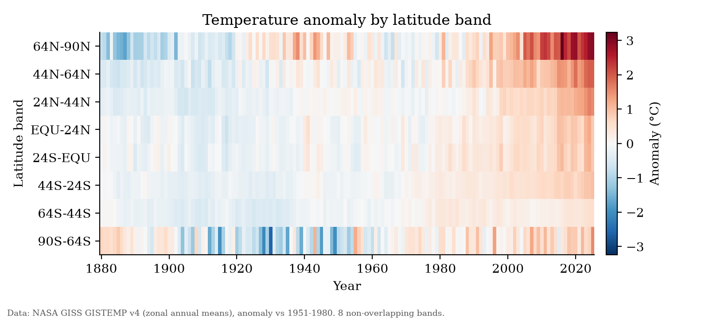

# How to Build Agentic AI Workflows for Research

Materials for a one-hour hands-on workshop given at **INL Days @ Boise State University**. It is for research faculty and students who have never used an AI coding agent.

Attendees use [Claude Code](https://code.claude.com/docs/en/overview) to take one public dataset, NASA's GISTEMP v4 zonal temperature anomalies, from raw CSV to figures, an interactive 3D model, and a database they can question in plain English. Each step teaches one habit that keeps agent-assisted research trustworthy.

## Why this workshop

A chatbot answers questions. An **agent** takes steps: it writes and runs code, looks at the results, and revises. That makes it useful for research. It also brings three risks: **unverified claims**, **irreproducible results** and **silent errors**.

The session teaches a workflow that addresses those risks:

1. **Plan before you act.** The agent proposes a plan, and you review and edit it before any code runs.
2. **Make the agent show its evidence.** After every result, it states one check it ran.
3. **Keep a human at the decision points.** The agent asks permission before it edits files or runs commands.
4. **Write the rules down.** A `CLAUDE.md` file works like lab rules for the agent: never touch raw data, label units and baselines, cite the source, and report how missing values were handled.

## The five stages

| Stage | What attendees do | What it teaches | Minutes |
|---|---|---|---|
| 0 Setup check | Claude describes the folder and its rules | The agent reads `CLAUDE.md` | 5 |
| 1 Plan | Get a plan in plan mode, then edit it | Review before execution | 7 |
| 2 Explore | Tidy the data and check for missing values | The raw columns overlap; choosing the 8 bands that don't is a real analysis decision | 7 |
| 3 Graphs | Make a global anomaly line chart and a latitude × year heatmap (PNG and SVG) | Figures are reproducible code; refine them in plain English | 7 |
| 4 3D | Build an interactive 3D surface in one offline HTML file (and an optional 3D-printable STL) | The same data can take a new form | 8 |
| 5 MCP | Load the data into SQLite and query it through a read-only [MCP](https://modelcontextprotocol.io) server | Moving from reading files to calling tools | 8 |
| Wrap-up | Fill in a prompt template for your own research | Transfer to your own work | 3 |

<p align="center">
  
</p>

## Try it yourself

You need Claude Code with a paid Claude plan or an API key (the free claude.ai plan doesn't include Claude Code), and [uv](https://docs.astral.sh/uv/).

1. Download [`attendee-kit.zip`](https://github.com/brandonbiggs/bsu-inl-days-2026/raw/main/dist/attendee-kit.zip) and unzip it, or use the [`attendee-kit/`](attendee-kit/) folder directly. From a terminal:
   ```
   curl -LO https://github.com/brandonbiggs/bsu-inl-days-2026/raw/main/dist/attendee-kit.zip
   unzip attendee-kit.zip
   ```
2. Follow the setup in [`attendee-kit/README.md`](attendee-kit/README.md). In short:
   ```
   uv sync
   uv run python verify_setup.py
   claude
   ```
3. Work through [`attendee-kit/prompts.md`](attendee-kit/prompts.md) stage by stage.

Your results will differ from the reference outputs and from run to run, because Claude writes new code each time. The numbers should match; the file names and styles won't. If you get stuck, each stage has a checkpoint folder with reference outputs, and a "Stuck?" prompt that copies them into `outputs/`.

Everything works **offline** once `uv sync` has run. No package installs or downloads are needed during the session, because venue Wi-Fi can't be trusted.

## What's in this repo

| Path | Contents |
|---|---|
| [`attendee-kit/`](attendee-kit/) | Everything attendees get. Includes the setup guide (`README.md`), every prompt in order (`prompts.md`), the agent's rules (`CLAUDE.md`), the raw NASA data, a setup checker, a small read-only SQLite MCP server, and reference checkpoints for each stage. |
| [`dist/attendee-kit.zip`](dist/attendee-kit.zip) | The kit as handed out, built from `attendee-kit/`. |
| [`presenter/SLIDES.md`](presenter/SLIDES.md) | The slide deck, in [Marp](https://marp.app) Markdown. |
| [`tools/`](tools/) | `package_kit.sh` builds the zip. `test_kit.sh` unzips it into a clean folder and checks that it works end to end. |

## Design choices

- **A bundled MCP server.** [`attendee-kit/mcp/sqlite_server.py`](attendee-kit/mcp/sqlite_server.py) is about 60 lines on the official MCP Python SDK. It is short enough to read before you trust it. It opens the database read-only, so the Stage 5 "try to delete everything" exercise fails safely.
- **No extra dependencies.** Only pandas, numpy, matplotlib, plotly and mcp, pinned in `uv.lock`. The STL file is written with numpy alone.
- **Cumulative checkpoints.** Each `checkpoints/stageN_*/outputs/` folder contains everything up to that stage, so one copy catches someone up.
- **The agent can't copy the answer key.** The kit's `CLAUDE.md` tells Claude not to read `checkpoints/` unless the user asks.

## For presenters and maintainers

```
tools/package_kit.sh                 # build dist/attendee-kit.zip from attendee-kit/
tools/test_kit.sh                    # unzip into a temp dir, uv sync, run the reference pipeline, check outputs and the MCP server
tools/test_kit.sh /path/to/python    # same, but use an existing Python instead of uv
```

`test_kit.sh` tests the built zip, not the working folder, so run `package_kit.sh` after any change to `attendee-kit/`. The test doesn't call Claude.

To regenerate the reference outputs, run the checkpoint scripts from inside `attendee-kit/`, as listed in [`attendee-kit/checkpoints/README.md`](attendee-kit/checkpoints/README.md).

Tested on macOS only. Windows and Linux are untested, so run through setup on a clean machine before presenting.

## Data and credit

Data: **NASA GISS GISTEMP v4**, zonal annual means, land and ocean ([`ZonAnn.Ts+dSST.csv`](https://data.giss.nasa.gov/gistemp/tabledata_v4/ZonAnn.Ts+dSST.csv)). Values are temperature anomalies in °C relative to the 1951-1980 baseline, for 1880-2025. NASA data are public domain in the US; NASA asks that you credit the source. The citation and column details are in [`attendee-kit/data/README.md`](attendee-kit/data/README.md).

The kit includes a copy downloaded on 2026-10-08. NASA updates the file monthly, so a fresh download may differ slightly in recent years.
