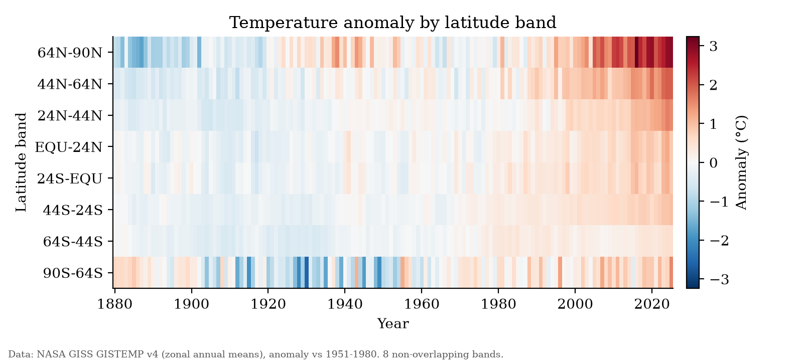

<!-- _class: lead -->
<!-- _paginate: false -->

# How to Build Agentic AI Workflows for Research

NASA GISTEMP v4 zonal temperature anomalies

You'll leave with outputs, the scripts that made them, and a template for your own work.

---

## What makes a workflow agentic?

**Plan → Act → Check → Revise**

LLM answers. An agent takes steps, looks at the results, and adjusts.

Research risks: **unverified claims** · **irreproducible results** · **silent errors**

---

## Today's map

**Setup → Plan → Explore → Graphs → 3D → MCP → Your research**

- Every stage makes something you can see
- Every stage has a checkpoint folder
- `CLAUDE.md` holds the lab rules

---

## Stage 1: Plan before you act

**Shift+Tab** until "plan mode on" (Windows: **Alt+M** if needed) or `/plan`

> I want to explore the GISTEMP data in data/ and produce a short report with two figures. Write scripts to generate figures.

Good plan?
- Assumptions stated?
- Output files named?
- Missing values handled?
- Verification step?

---

## Stage 2: Iterate and Execute

Before approving the plan, review and modify. When happy with the plan, approve it.

---

## Stage 3: Figures are code

- Line chart + latitude × year heatmap
- PNG + SVG
- Iterate in plain English
- New data? Rerun one script.

---

## Stage 4: Same data, new representation

Interactive 3D surface in **one self-contained HTML file**

---

## Stage 5: MCP, from reading files to using tools

| Stage 2 | Stage 5 |
|---|---|
| Claude opens a CSV and writes code against it | Claude calls a database through a structured tool interface |

List tables · Describe · Read-only query

**One protocol, many servers.**

---

## What else could you connect?

Examples, not demos

- Reference managers (e.g. Zotero)
- Cloud drives (e.g. Google Drive)
- Literature search (e.g. PubMed)
- Institutional databases / data warehouses

⚠️ MCP servers run with your permissions.

---

## Take it home

> "I study **[field]**. I have **[data]**. I want to **[goal]**.
> Make a plan with stages, outputs, and checks..."

1. **Define stages and outputs first.**
2. **Make the agent show its evidence.**
3. **Keep a human at the decision points.**

